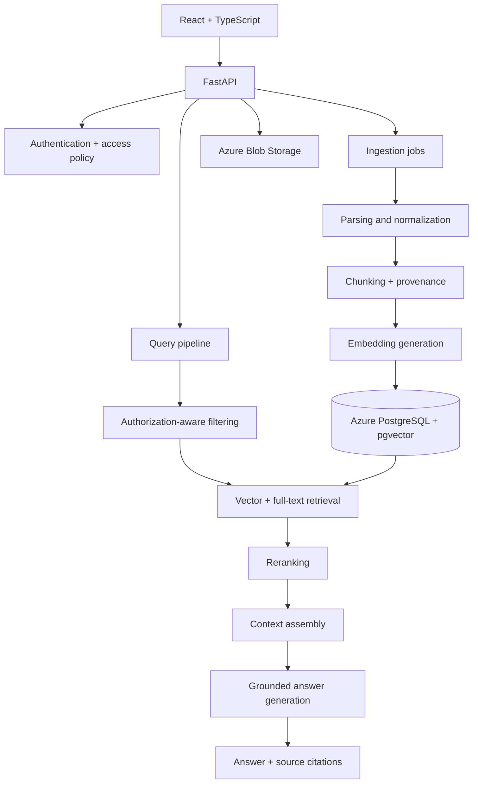

# Enterprise Knowledge Intelligence

> **Status: Planning / Initial development** · A portfolio project focused on retrieval quality, access-aware search, and grounded answers over enterprise knowledge.

A full-stack **Retrieval-Augmented Generation (RAG)** application for searching internal documents and technical knowledge with verifiable source references. The project emphasizes **data ingestion, hybrid retrieval, reranking, access control, and measurable evaluation**, rather than only building a chat interface.

The initial demo will use public or synthetic content such as PDF, Markdown, and C# source files. Enterprise connectors will be simulated or added incrementally.

## Problem

Company knowledge is spread across documents, technical repositories, and storage systems. Basic keyword search may miss semantically related information, while naive vector-only RAG can retrieve irrelevant chunks or expose content to unauthorized users.

This project explores how to build a maintainable retrieval system that can answer questions with **relevant, authorized, traceable evidence**.

## Planned capabilities

- Ingest PDF, Markdown, and C# files with source metadata
- Parse, normalize, and chunk content with configurable strategies
- Generate embeddings and index content in PostgreSQL with **pgvector**
- Combine vector similarity and PostgreSQL full-text search (**hybrid retrieval**)
- Rerank candidate passages before context assembly
- Generate answers with citations to source documents/chunks
- Filter results by tenant, project, and document access rules
- Support document updates, versioning, and incremental re-indexing
- Measure retrieval and answer quality against a curated evaluation set
- Provide a React UI for upload, search, answers, and source inspection

## Architecture (target)



**Security principle:** authorization must be applied before any retrieved content is returned to the user or passed to the LLM. Prompt instructions alone are not access control.

## Technology stack (planned)

| Layer | Technologies |
| --- | --- |
| Frontend | React, TypeScript, Vite, Tailwind CSS, shadcn/ui |
| Backend | Python, FastAPI, Pydantic |
| Retrieval | Custom Python pipeline; PostgreSQL full-text search + pgvector |
| Reranking | Model/provider to be selected and benchmarked |
| Embeddings / generation | Model/provider to be selected |
| Data access | SQLAlchemy 2.x, Alembic |
| Database | Azure Database for PostgreSQL with pgvector |
| Parsing | PyMuPDF, python-docx if DOCX support is added, language-aware text parsing |
| File storage | Azure Blob Storage |
| Testing | pytest, Vitest |
| Quality | Ruff, mypy, ESLint, TypeScript |
| Infrastructure | Docker, Azure Container Apps, Azure Static Web Apps, Bicep |
| CI/CD | GitHub Actions |

The project will implement core retrieval steps explicitly before deciding whether a framework such as LlamaIndex or LangChain adds enough value.

## Retrieval pipeline (planned)

1. Authenticate the user and determine their authorized scope.
2. Normalize the query and construct access-aware search filters.
3. Retrieve candidates through vector similarity and full-text search.
4. Fuse results and rerank candidate passages.
5. Build a bounded context containing source identifiers and locations.
6. Generate an answer grounded in retrieved evidence.
7. Return citations and handle insufficient evidence explicitly.

For ingestion, each chunk will retain source-document identity, version, and location so citations can be verified and stale chunks replaced.

## Evaluation plan

A small, version-controlled question set will be prepared **before** tuning retrieval. It will include:

- Exact terminology and identifier lookups
- Semantic paraphrases
- Questions requiring multiple source passages
- Similar documents with conflicting versions
- Questions with no supporting evidence
- Unauthorized documents that must not appear in retrieval

Planned measurements:

| Area | Candidate metrics |
| --- | --- |
| Retrieval | Recall@k, Precision@k, MRR / nDCG |
| Answers | Citation support, faithfulness, answer correctness |
| Access control | Unauthorized retrieval rate (target: zero) |
| Operations | Ingestion duration, query latency, cost per query |

Baselines will compare **keyword search**, **vector-only search**, and **hybrid + reranking** on the same evaluation set. **No benchmark results are claimed yet.**

## Engineering considerations

- **Incremental ingestion:** detect changed files and avoid duplicate chunks.
- **Versioning:** retain provenance and prevent stale versions from silently dominating results.
- **ACL:** enforce document-level permissions at retrieval time and test negative cases.
- **Observability:** record ingestion failures, retrieval timing, selected sources, and token usage without leaking sensitive content.
- **Reliability:** use bounded retries, idempotent ingestion operations, and explicit failure states.
- **Security:** treat document contents as untrusted data; defend against prompt injection in retrieved text.

## Development roadmap

- [ ] Bootstrap React, FastAPI, PostgreSQL/pgvector, Docker, and CI
- [ ] Build document upload and metadata models
- [ ] Implement PDF/Markdown/C# parsing and chunk provenance
- [ ] Add embedding generation and vector search baseline
- [ ] Add full-text search and hybrid result fusion
- [ ] Add reranking and grounded answer citations
- [ ] Implement document-level ACL and negative authorization tests
- [ ] Support incremental ingestion and document version updates
- [ ] Build evaluation dataset and publish comparative metrics
- [ ] Deploy live demo with Azure and GitHub Actions

## Local development

> **Not available yet.** Verified setup instructions will be added after the initial application scaffold is committed.

Expected layout:

```text
frontend/       # React + TypeScript
backend/        # FastAPI, ingestion and retrieval pipelines
infra/          # Azure Bicep modules and parameters
docs/           # Architecture, retrieval experiments, evaluation
.github/        # CI/CD workflows
```

A future `.env.example` will document configuration without including secrets. The local environment will use Dockerized PostgreSQL with pgvector.

## CI/CD and deployment (planned)

- **Pull requests:** Python lint/type checks/tests; frontend checks/build; Bicep validation.
- **Main branch:** deploy React and FastAPI; run controlled Alembic migrations and smoke tests.
- **Hosting:** Azure Static Web Apps, Azure Container Apps, Azure Database for PostgreSQL, Azure Blob Storage.
- **Evaluation:** fast deterministic checks in CI; paid model-based evaluation as a separately triggered workflow.

**Live demo:** Coming soon. A bounded demo corpus and query limits will be provided to manage cost and protect the service.

## Documentation

Design decisions, retrieval experiments, sample datasets, architecture diagrams, and evaluation reports will be published under `docs/` as they become available.

## Data and licensing

This is an independent portfolio project. Public demonstration content will be synthetic, public-domain, or used under an appropriate license. No private corporate repositories or documents will be published.

**License:** To be decided. No license is granted by default until a license file is added.
