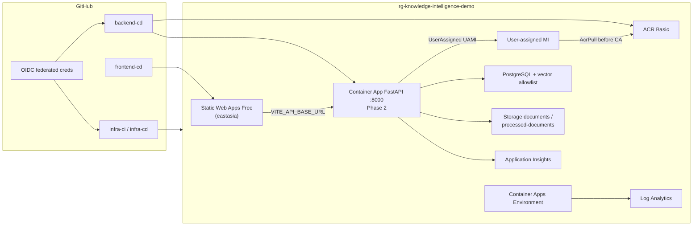

# Enterprise Knowledge Intelligence — Azure Infrastructure

Independent Azure infrastructure for the RAG portfolio **demo**. All application resources live in resource group **`rg-knowledge-intelligence-demo`**. This stack does **not** share resources with Enterprise AI Agent Platform.

| Concern | Value |
| --- | --- |
| Azure environment | **Single `demo`** (no separate Azure staging/production yet) |
| Resource group | `rg-knowledge-intelligence-demo` |
| Parameters file | [`parameters/demo.bicepparam`](parameters/demo.bicepparam) |
| GitHub Environment | `demo` |
| Data plane / API region | `australiasoutheast` |
| Static Web Apps region | `eastasia` (SWA unavailable in Australia Southeast) |
| Prefix | `eki` |
| IaC | Bicep |
| Secrets (MVP) | Container Apps secrets + GitHub Environment secrets (no Key Vault) |

**Deployment flow:** Local Development → Pull Request CI → Merge to Main → Azure Demo.

Bicep modules stay environment-agnostic via `param environment`; add `staging.bicepparam` / `production.bicepparam` later without rewriting modules.

**Greenfield dependency order (empty RG):** Log Analytics completes first; Application Insights and the Container Apps Environment both consume LAW outputs (`id` / `customerId` + secure `primarySharedKey`). The CAE shared key comes from the LAW module output — not a parent-template `listKeys(resourceId(...))` call — so key lookup cannot race ahead of workspace creation.

**Do not deploy to Azure until you explicitly approve a live deployment.**

---

## Architecture



### Resource inventory

| Resource | Notes |
| --- | --- |
| Log Analytics | PerGB2018, 30-day retention |
| Application Insights | Workspace-based |
| ACR | Basic; admin **disabled** |
| Storage | Standard_LRS; private `documents`, `processed-documents`; HTTPS + TLS 1.2; shared keys **disabled** |
| PostgreSQL Flexible Server | Burstable `Standard_B1ms`; DB `knowledge_intelligence_db`; **`azure.extensions=vector`** |
| UAMI | Created in Phase 1; **AcrPull before** any Container App |
| Container Apps Environment | Consumption; no custom VNet |
| Container App | Phase 2; port 8000; `/health`; min 0 / max 2; **UserAssigned** UAMI |
| Static Web Apps | Free in **`eastasia`** |

**Not provisioned:** Key Vault, Azure OpenAI, Azure AI Search, Storage Queues, worker Jobs, VNet/private endpoints.

---

## Phased deployment

1. **Bootstrap** — subscription → `rg-knowledge-intelligence-demo`
2. **Phase 1** (`deployContainerApp = false`): LAW, AI, ACR, Storage, PostgreSQL (+ vector allowlist), CAE, SWA, **UAMI**, **AcrPull on UAMI**
3. **Manual once** — GitHub OIDC Entra app + RBAC (not in Bicep)
4. **Phase 1.5** — Create least-privilege `eki_app` with [`scripts/create-postgres-app-user.sh`](scripts/create-postgres-app-user.sh) (`CONNECT` + `USAGE` only); push first FastAPI image to ACR
5. **Phase 2** (`deployContainerApp = true` + `containerImage`): Container App (UAMI + `eki_app` Postgres env) + Blob Data Contributor on UAMI
6. **Alembic (as `pgadmin`)** — `CREATE EXTENSION vector;` + application schema
7. **Grant DML** — [`scripts/grant-postgres-app-user-dml.sh`](scripts/grant-postgres-app-user-dml.sh) before serving traffic with FastAPI (avoids connect-OK / table permission-denied)
8. **Ongoing** — backend-cd / frontend-cd only for app releases

---

## PostgreSQL + pgvector

### Infrastructure (Bicep)

- Allowlists the Azure extension name **`vector`** via server configuration `azure.extensions`.
- Creates database `knowledge_intelligence_db` only (no tables).
- Full-text search uses built-in PostgreSQL (`tsvector`); no Azure AI Search.

### Application (not Bicep)

```sql
CREATE EXTENSION IF NOT EXISTS vector;
-- Then Alembic: tables, vector columns, HNSW/IVFFlat, FTS indexes, tenant/ACL columns.
```

| Account | Use |
| --- | --- |
| `pgadmin` (admin) | Flexible Server admin; Alembic / bootstrap SQL only |
| `eki_app` | FastAPI runtime (`POSTGRES_USER` / `POSTGRES_PASSWORD`) |

Create the app role before Phase 2 (password stays in env — never edit the SQL file):

```bash
export POSTGRES_HOST='<flexible-server-fqdn>'
export POSTGRES_ADMIN_PASSWORD='...'
export POSTGRES_APP_PASSWORD='...'
./infra/scripts/create-postgres-app-user.sh   # CONNECT + USAGE only (no tables yet)
```

After Alembic creates tables (still as `pgadmin`), grant DML **before** FastAPI uses `eki_app`:

```bash
# same POSTGRES_HOST / POSTGRES_ADMIN_PASSWORD
./infra/scripts/grant-postgres-app-user-dml.sh
```

That grants `SELECT/INSERT/UPDATE/DELETE` on existing tables, `USAGE/SELECT` on sequences, and `ALTER DEFAULT PRIVILEGES` for future admin-created objects. Re-run after migrations that add tables if needed.

The create-user wrapper never puts secrets on the `psql` command line (they show in process listings). Admin auth uses a temporary mode-0600 `PGPASSFILE`; the app password is written into a temporary mode-0600 SQL file with dollar-quoting, then both temps are deleted. Do **not** put the admin password on the Container App.

Allowlisting alone does **not** install the extension.

### Networking

| Setting | Module default | `demo.bicepparam` |
| --- | --- | --- |
| `allowAzureServicesAccess` | `false` | **`true`** (warning comment) |

**Dev tradeoff:** any Azure IP may *attempt* auth; mitigate with TLS (`sslmode=require`), strong password, no committed credentials.

**Production must keep `allowAzureServicesAccess = false`** and use IP allowlists (with static egress) or private networking. Do not enable broad Azure-services access in production parameter files.

---

## Secret injection — dual-path (CI-safe)

Empty `.bicepparam` defaults are for file evaluation only. **Deploy is gated** by [`scripts/validate-deploy-secrets.sh`](scripts/validate-deploy-secrets.sh):

| Gate | Rule |
| --- | --- |
| Always | `POSTGRES_ADMIN_PASSWORD` non-empty |
| When `deployContainerApp = true` | `POSTGRES_APP_PASSWORD` + `LLM_API_KEY` non-empty, and `containerImage` set |

### Local

```bash
export POSTGRES_ADMIN_PASSWORD='YourStrong!Admin-Password'
export POSTGRES_APP_PASSWORD='YourStrong!App-Password'   # required when deployContainerApp=true
export LLM_API_KEY='sk-...'                             # required when deployContainerApp=true

./infra/scripts/validate-deploy-secrets.sh infra/parameters/demo.bicepparam

az deployment group create \
  --resource-group rg-knowledge-intelligence-demo \
  --template-file infra/main.bicep \
  --parameters infra/parameters/demo.bicepparam
```

### CI (`infra-cd.yml`)

Environment **`demo`** secrets `POSTGRES_ADMIN_PASSWORD` (+ `POSTGRES_APP_PASSWORD` / `LLM_API_KEY` for Phase 2):

```bash
az deployment group create \
  --parameters infra/parameters/demo.bicepparam \
  --parameters \
    postgresAdminPassword="${POSTGRES_ADMIN_PASSWORD}" \
    postgresAppPassword="${POSTGRES_APP_PASSWORD:-}" \
    llmApiKey="${LLM_API_KEY:-}"
```

Azure CLI later `--parameters` **overrides** the `.bicepparam` values.

### Connection URL (app responsibility)

Bicep does **not** build a connection string (avoids password URL-encoding bugs). The Container App receives:

| Variable | Notes |
| --- | --- |
| `POSTGRES_HOST` | Flexible Server FQDN |
| `POSTGRES_PORT` | `5432` |
| `POSTGRES_DB` | `knowledge_intelligence_db` |
| `POSTGRES_USER` | `eki_app` |
| `POSTGRES_PASSWORD` | secretRef `postgres-password` |

Build the URL in Python:

```python
from sqlalchemy.engine import URL

database_url = URL.create(
    drivername="postgresql+psycopg",
    username=os.environ["POSTGRES_USER"],
    password=os.environ["POSTGRES_PASSWORD"],
    host=os.environ["POSTGRES_HOST"],
    port=int(os.environ["POSTGRES_PORT"]),
    database=os.environ["POSTGRES_DB"],
    query={"sslmode": "require"},
)
```

---

## Container Apps secret ownership (Option A)

**Single owner:** Bicep declares **both** Container App secrets. Do **not** also set `llm-api-key` via CLI or the portal — a Bicep `secrets` array is **replace-semantics** and would wipe undeclared secrets on the next infra deploy.

| Secret | Owner | In Bicep? | How updated |
| --- | --- | --- | --- |
| `postgres-password` (`eki_app`) | IaC | Yes | Dual-path `postgresAppPassword` on every infra CD that touches the CA |
| `llm-api-key` | IaC | Yes | Dual-path `llmApiKey` on every infra CD that touches the CA |
| SWA deploy token | Infra → GitHub | N/A | frontend-cd |

### Redeploy rule

- Prefer routine releases via **backend CD** (`az containerapp update --image` only — no secret CLI).
- When you do run infra CD with `deployContainerApp = true`, always re-supply **both** `postgresAppPassword` and `llmApiKey`.

---

## UAMI and RBAC

**Phase 1 (Bicep):** create UAMI → assign **AcrPull** on ACR to UAMI **before** any Container App.

**Phase 2 (Bicep):** Container App `identity.type = UserAssigned`; registry `identity = <uami resource id>`; assign **Storage Blob Data Contributor** to the same UAMI; set `AZURE_CLIENT_ID` to UAMI client ID for DefaultAzureCredential.

**GitHub OIDC (manual once — not in Bicep):**

1. App registration + federated credential for Environment `demo`
2. Secrets: `AZURE_CLIENT_ID`, `AZURE_TENANT_ID`, `AZURE_SUBSCRIPTION_ID`
3. Assign least privilege (e.g. RG `Contributor`, or `AcrPush` + Container Apps Contributor)

```bash
az role assignment create \
  --assignee <oidc-app-client-id> \
  --role Contributor \
  --scope /subscriptions/<sub-id>/resourceGroups/rg-knowledge-intelligence-demo
```

Azure RBAC ≠ application tenant/document ACL.

---

## Azure CLI (when approved)

### Bootstrap

```bash
az deployment sub create \
  --location australiasoutheast \
  --template-file infra/bootstrap/main.bicep \
  --parameters resourceGroupName=rg-knowledge-intelligence-demo location=australiasoutheast
```

### Phase 1

```bash
export POSTGRES_ADMIN_PASSWORD='...'
./infra/scripts/validate-deploy-secrets.sh infra/parameters/demo.bicepparam
az deployment group create \
  --resource-group rg-knowledge-intelligence-demo \
  --template-file infra/main.bicep \
  --parameters infra/parameters/demo.bicepparam
```

### Phase 2

1. Run [`scripts/create-postgres-app-user.sh`](scripts/create-postgres-app-user.sh).
2. Edit `demo.bicepparam`: `deployContainerApp = true` and set `containerImage`.
3. Export `POSTGRES_ADMIN_PASSWORD`, `POSTGRES_APP_PASSWORD`, and `LLM_API_KEY`, run `validate-deploy-secrets.sh`, then redeploy.

### SWA token

```bash
az staticwebapp secrets list -g rg-knowledge-intelligence-demo -n <swa-name> \
  --query properties.apiKey -o tsv
```

Store as `AZURE_STATIC_WEB_APPS_API_TOKEN`. Token is **region-agnostic** even though SWA is in `eastasia`.

---

## Frontend

- Inject API URL via GitHub **variable** `VITE_API_BASE_URL` (public HTTPS URL — not a secret).
- CORS: set Container App `CORS_ALLOWED_ORIGINS` / `corsAllowedOrigins` to include the SWA origin + localhost.
- Add `staticwebapp.config.json` navigation fallback when the React app is scaffolded.

---

## GitHub Actions

| Workflow | Trigger | Role |
| --- | --- | --- |
| `infra-ci.yml` | `infra/**` | build + lint; optional what-if |
| `infra-cd.yml` | manual + Environment `demo` | bootstrap optional; deploy with admin/app/LLM overrides (Option A) |
| `backend-cd.yml` | `backend/**` / manual | skip if no Dockerfile; ACR build; image-only update; `/health` |
| `frontend-cd.yml` | `frontend/**` / manual | skip if no package.json; build + SWA |

### Environment `demo` secrets / variables

**Secrets:** `AZURE_CLIENT_ID`, `AZURE_TENANT_ID`, `AZURE_SUBSCRIPTION_ID`, `POSTGRES_ADMIN_PASSWORD`, `POSTGRES_APP_PASSWORD` (Phase 2), `LLM_API_KEY` (Phase 2 Option A), `AZURE_STATIC_WEB_APPS_API_TOKEN`

**Variables:** `ACR_NAME`, `CONTAINER_APP_NAME`, `VITE_API_BASE_URL`, optional `RUN_INFRA_WHAT_IF=true`

---

## Observability

Creating Application Insights does **not** instrument Python. Use OpenTelemetry / `azure-monitor-opentelemetry` with `APPLICATIONINSIGHTS_CONNECTION_STRING`. Do **not** log raw documents, prompts, credentials, or sensitive retrieved content by default.

---

## Public demo controls (application + ops)

This Azure stack is the **public resume/GitHub live demo**, not a multi-environment SaaS estate. When the FastAPI/React apps are implemented, enforce and document:

| Control | Intent |
| --- | --- |
| Synthetic / public demo corpora only | No private corporate knowledge bases |
| Rate limiting | Cap query/upload rates per IP / session |
| LLM + embedding usage limits | Token/call budgets; fail closed when exceeded |
| Restricted access | Optional demo auth, invite-only, or throttled anonymous search |
| Document size / count limits | Bound Blob growth and ingestion cost |
| Cost Management budget alerts | Notify on spend; alerts are **not** hard caps |
| Scale-to-zero Container Apps | Reduce idle API cost; Postgres B1ms remains the main always-on cost |
| Delete RG when idle | Tear down `rg-knowledge-intelligence-demo` between demos if needed |

Do not log raw documents or prompts to App Insights by default. Keep `VITE_API_BASE_URL` as a public variable only.

## Cost

| Resource | Idle note |
| --- | --- |
| PostgreSQL B1ms | **Largest always-on** cost |
| ACR Basic | Small always-on fee |
| Container Apps | Scale-to-zero when min=0 |
| SWA Free | Negligible |
| Storage / LAW / AI | Usage-based |

Budget **alerts** in Cost Management notify; they are **not** hard spend caps. Delete the RG when the demo is idle.

---

## Future ingestion (not provisioned)

```text
FastAPI → Storage Queue → Python worker → Parse → Chunk → Embed → PostgreSQL + pgvector
```

Include retries, idempotency, failed-job handling. Do not treat FastAPI `BackgroundTasks` as durable production processing.

---

## Local validation (no Azure deploy)

```bash
az bicep build --file infra/bootstrap/main.bicep
az bicep build --file infra/main.bicep
az bicep lint --file infra/bootstrap/main.bicep
az bicep lint --file infra/main.bicep
```

### What local validation cannot prove

- Live `what-if` / deployment against a subscription
- Real AcrPull / Blob RBAC effect at runtime
- Actual ACA secret wipe/restore behavior in Azure
- Provider registration / SKU quota
- End-to-end GitHub runner password override (documented via CLI parameter precedence + empty-default fallback)

---

## Cleanup

```bash
az group delete --name rg-knowledge-intelligence-demo --yes --no-wait
```

Independent of other portfolio projects.

---

## Layout

```text
infra/
  bootstrap/main.bicep
  main.bicep
  modules/
    app-insights.bicep
    container-app.bicep
    container-app-env.bicep
    container-registry.bicep
    identity-rbac.bicep
    log-analytics.bicep
    managed-identity.bicep
    postgresql.bicep
    static-web-app.bicep
    storage.bicep
  parameters/demo.bicepparam
  scripts/create-postgres-app-user.sh
  scripts/create-postgres-app-user.sql
  scripts/grant-postgres-app-user-dml.sh
  scripts/grant-postgres-app-user-dml.sql
  scripts/validate-deploy-secrets.sh
  README.md
```
