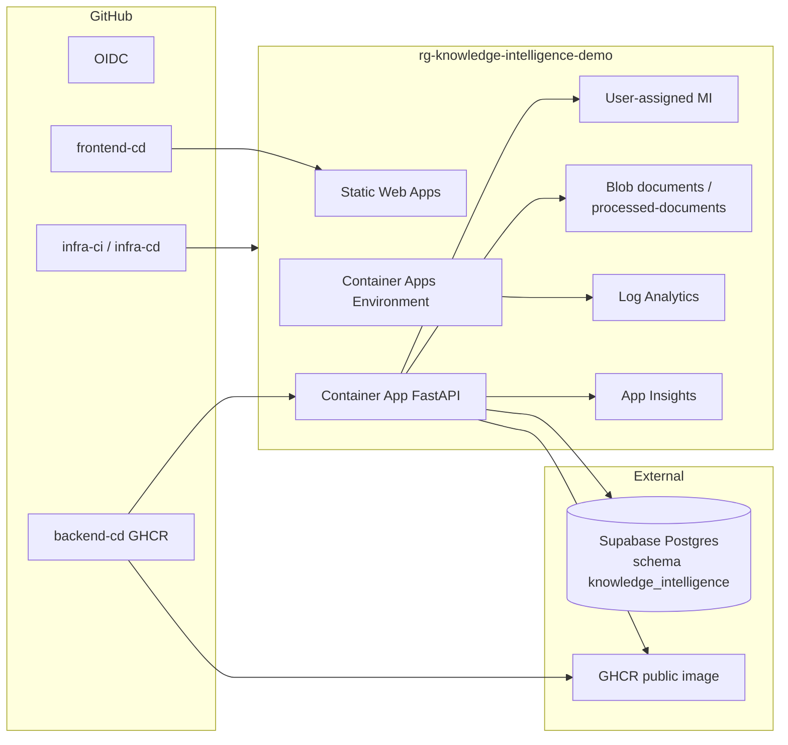

# Enterprise Knowledge Intelligence — Azure Infrastructure

Independent Azure infrastructure for the portfolio SaaS **demo**. Resource group: **`rg-knowledge-intelligence-demo`**.

| Concern | Value |
| --- | --- |
| Azure environment | **Single `demo`** |
| Resource group | `rg-knowledge-intelligence-demo` |
| Parameters | [`parameters/demo.bicepparam`](parameters/demo.bicepparam) |
| GitHub Environment | `demo` |
| Data plane / API region | `australiasoutheast` |
| Static Web Apps region | `eastasia` |
| Database | **External Supabase PostgreSQL** + pgvector (schema `knowledge_intelligence`) |
| Container images | **Public GHCR** (`ghcr.io/<user>/<image>:<tag>`) |
| Secrets (MVP) | Container Apps secrets + GitHub Environment secrets (no Key Vault) |

**Do not deploy to Azure until you explicitly approve a live deployment.**

Shares one Supabase project with Agent Platform; isolation is by **PostgreSQL schema** (`knowledge_intelligence` vs `agent_platform`).

---

## Architecture



### Resource inventory (provisioned)

| Resource | Notes |
| --- | --- |
| Log Analytics | PerGB2018 |
| Application Insights | Workspace-based |
| Storage Account | `documents` / `processed-documents`; shared keys disabled |
| User-assigned managed identity | Attached to Container App; Blob Data Contributor assigned **manually** (see below) |
| Container Apps Environment | Consumption |
| Container App | Optional (`deployContainerApp`); public GHCR image; probes `/health` |
| Static Web Apps | Free; `eastasia` |

Azure PostgreSQL and ACR are **not** provisioned by this stack (database is Supabase; images are public GHCR).

---

## Phased deployment

1. **Bootstrap** — create `rg-knowledge-intelligence-demo`.
2. **Phase 1** — `deployContainerApp = false`: LAW, App Insights, Storage, UAMI, CAE, SWA (no Container App yet).
3. **Manual once** — GitHub OIDC + RBAC; run [`scripts/supabase-setup.sql`](scripts/supabase-setup.sql); build/push a **public** GHCR image.
4. **Phase 2** — enable Container App (see below), redeploy infra.
5. **Ongoing** — `backend-cd` / `frontend-cd`. Prefer app CD over full infra CD.

### Enable Container App (Phase 2) — do this when the API image exists

The Container App is **not** created in Phase 1. To provision it:

1. Ensure `backend/Dockerfile` builds and `/health` works locally.
2. Publish a **public** image, e.g. `ghcr.io/<github-username>/knowledge-intelligence-api:latest`  
   (GitHub → Packages → package settings → Public). Private packages fail ACA pulls (no registry credentials in Bicep).
3. Edit [`parameters/demo.bicepparam`](parameters/demo.bicepparam):

   ```bicep
   param deployContainerApp = true
   param containerImage = 'ghcr.io/<github-username>/knowledge-intelligence-api:latest'
   ```

4. Set GitHub Environment `demo` secret `DATABASE_URL` (Supabase session pooler). `LLM_API_KEY` is optional.
5. Redeploy infra (`infra-cd` with `confirm_destructive=DEPLOY`, or `bash scripts/infra/deploy.sh`).
6. **Once (Owner login):** grant the UAMI Blob access (Bicep does not create role assignments — GitHub OIDC is Contributor-only):

   ```bash
   RG=rg-knowledge-intelligence-demo
   UAMI_PRINCIPAL_ID=$(az identity show -g "$RG" -n eki-demo-uami --query principalId -o tsv)
   STORAGE=$(az storage account list -g "$RG" --query "[0].name" -o tsv)

   az role assignment create \
     --assignee-object-id "$UAMI_PRINCIPAL_ID" \
     --assignee-principal-type ServicePrincipal \
     --role "Storage Blob Data Contributor" \
     --scope "$(az storage account show -g "$RG" -n "$STORAGE" --query id -o tsv)"
   ```

7. From deployment outputs, set GitHub vars:
   - `CONTAINER_APP_NAME` (e.g. `eki-demo-api`)
   - `VITE_API_BASE_URL` = Container App URL
8. Copy SWA deployment token → secret `AZURE_STATIC_WEB_APPS_API_TOKEN`, then run `frontend-cd`.

---

## Supabase (manual)

Bicep does **not** create schemas or DB users. Run once against the shared project:

```sql
CREATE SCHEMA IF NOT EXISTS knowledge_intelligence;
CREATE EXTENSION IF NOT EXISTS vector WITH SCHEMA extensions;
```

Full notes (Alembic `version_table_schema`, grants): [`scripts/supabase-setup.sql`](scripts/supabase-setup.sql).

Prefer the **session pooler** host in `DATABASE_URL` (IPv4-friendly). Set `POSTGRES_SCHEMA=knowledge_intelligence` (non-secret env on the Container App) so SQLAlchemy/Alembic stay isolated from `agent_platform`.

---

## Secrets and environment variables

| Variable / secret | When required | Purpose |
| --- | --- | --- |
| `AZURE_SUBSCRIPTION_ID` | Local `scripts/infra/deploy.sh` | Target subscription check |
| `AZURE_CLIENT_ID` / `AZURE_TENANT_ID` / `AZURE_SUBSCRIPTION_ID` | GitHub OIDC | Azure login |
| `DATABASE_URL` | When `deployContainerApp = true` | Supabase session-pooler URL → ACA secret `database-url` → env `DATABASE_URL` |
| `LLM_API_KEY` | Optional | When set, scripts pass `enableLlmApiKey=true` + `llmApiKey` → ACA secret `llm-api-key`. Omit until LLM is wired. |
| `containerImage` (param) | When `deployContainerApp = true` | Public `ghcr.io/...` reference |
| `AZURE_STATIC_WEB_APPS_API_TOKEN` | frontend-cd | SWA deploy |
| `CONTAINER_APP_NAME` (GitHub var) | backend-cd | Image update target |
| `VITE_API_BASE_URL` (GitHub var) | frontend-cd | Public API URL |

**Never** commit `DATABASE_URL`. Example shape (do not commit real values):

```text
postgresql+psycopg://postgres.<project-ref>:<password>@aws-0-<region>.pooler.supabase.com:5432/postgres
```

### Option A secret ownership

Bicep declares `database-url` always (Phase 2) and `llm-api-key` only when `enableLlmApiKey=true` (ARM cannot reliably `empty()` a `@secure()` value). Do not manage secrets via CLI/portal — a Bicep `secrets` array is replace-semantics. backend-cd updates **image only**.

### Validate before deploy

```bash
export DATABASE_URL='...'   # Phase 2 (required)
# export LLM_API_KEY='...'  # optional until LLM integration
./infra/scripts/validate-deploy-secrets.sh infra/parameters/demo.bicepparam
```

Phase 1 (`deployContainerApp = false`) needs no DB/LLM secrets.

---

## Local deploy

```bash
export AZURE_SUBSCRIPTION_ID='...'
# Phase 2:
export DATABASE_URL='...'
# export LLM_API_KEY='...'   # optional
bash scripts/infra/deploy.sh
```

---

## GHCR (public images)

- Image format: `ghcr.io/<github-username>/knowledge-intelligence-api:<tag>`
- Container App has **no** `registries` credentials — package visibility must be **Public**.
- `backend-cd` builds/pushes with `packages: write` + `GITHUB_TOKEN`, then `az containerapp update --image`.

---

## GitHub Actions

| Workflow | Role |
| --- | --- |
| `infra-ci.yml` | Bicep build/lint; optional what-if |
| `infra-cd.yml` | Manual deploy; `DATABASE_URL` override (+ optional `LLM_API_KEY`) |
| `backend-cd.yml` | GHCR build/push; Container App image update; `/health` |
| `frontend-cd.yml` | SWA deploy |

**Environment `demo` secrets:** `AZURE_CLIENT_ID`, `AZURE_TENANT_ID`, `AZURE_SUBSCRIPTION_ID`, `DATABASE_URL` (Phase 2), `LLM_API_KEY` (optional), `AZURE_STATIC_WEB_APPS_API_TOKEN`

**Variables:** `CONTAINER_APP_NAME`, `VITE_API_BASE_URL`, optional `RUN_INFRA_WHAT_IF`

---

## Health probes

| Probe | Path |
| --- | --- |
| Startup / Liveness / Readiness | `/health` |

---

## Local Bicep validation

```bash
az bicep build --file infra/bootstrap/main.bicep
az bicep build --file infra/main.bicep
az bicep lint --file infra/bootstrap/main.bicep
az bicep lint --file infra/main.bicep
```

---

## Layout

```text
infra/
  bootstrap/main.bicep
  main.bicep
  modules/
    app-insights.bicep
    container-app.bicep
    container-app-env.bicep
    identity-rbac.bicep      # unused by main (manual Blob RBAC; kept for reference)
    log-analytics.bicep
    managed-identity.bicep
    static-web-app.bicep
    storage.bicep
  parameters/demo.bicepparam
  scripts/
    validate-deploy-secrets.sh
    supabase-setup.sql
  README.md
```

**Deleted modules (obsolete):** `postgresql.bicep`, `container-registry.bicep`  
**Deleted scripts (obsolete):** `create-postgres-app-user.*`, `grant-postgres-app-user-dml.*`  
**Not wired from `main.bicep`:** `identity-rbac` (role assignments require Owner / User Access Administrator; assign Blob Data Contributor manually after Phase 2).
